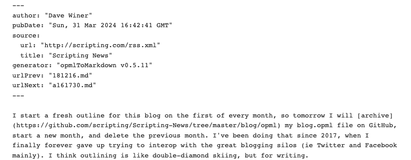
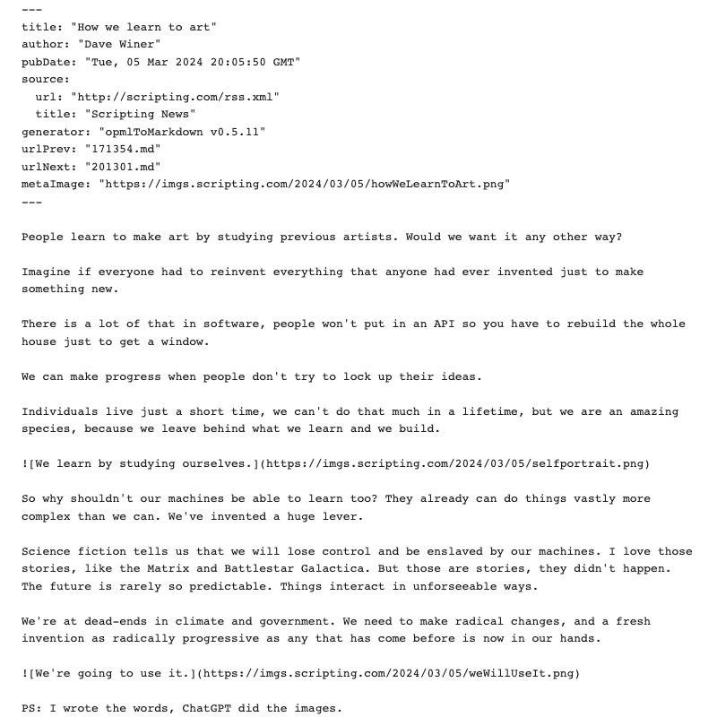
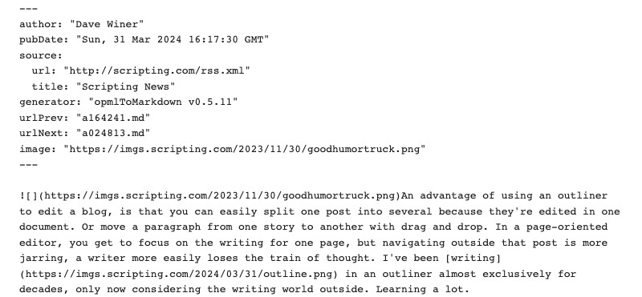
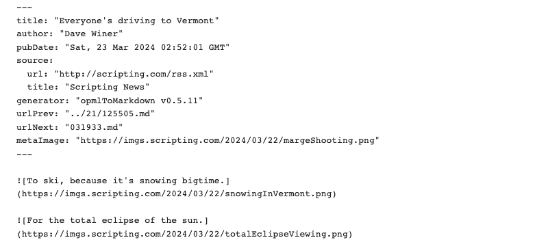
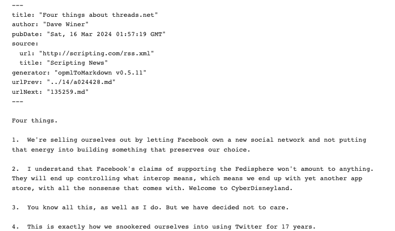
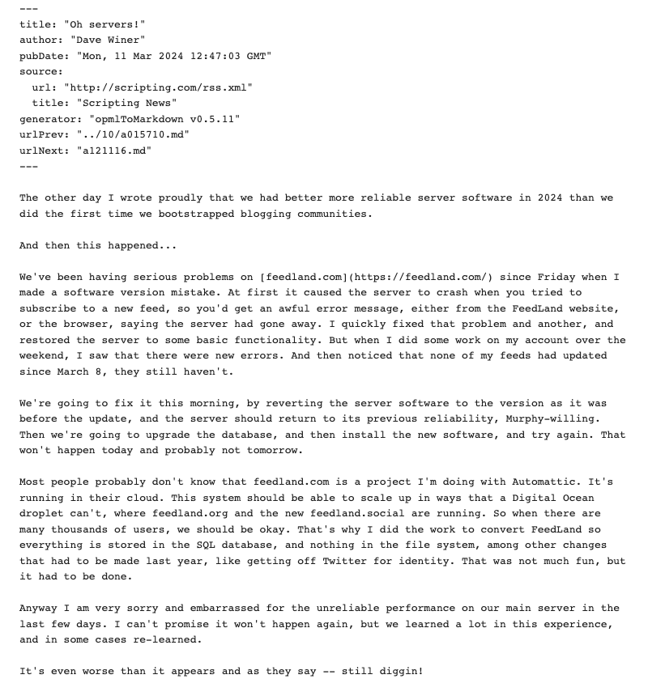
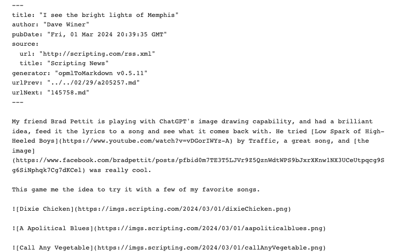
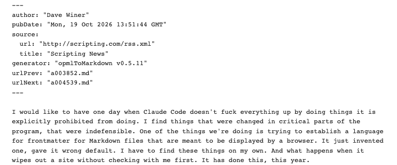

This post has a right margin image from March 12, 2024. It's about a friend who had landed a big job at the NYT with ideas on how they could use AI.  

### Example 0

An untitled <a href="http://scripting.com/2024/03/31.html#a164241">blog post</a> from March 21, 2024, explaining how I had been using OPML to write and archive my blog writing starting in 2017.  The source attribute provides the address of the feed it came from. When displaying a post you might want to refer to some info from the feed, such as its title, link, icon. 

### Example 1

A <a href="http://scripting.com/2024/03/05/200550.html">titled blog post</a> from March 5, 2024 about some of my discoveries in creating art with ChatGPT.

### Example 2

An untitled post with a <a href="http://scripting.com/2024/03/31.html#a161730">right-margin image</a>, a Good Humor ice cream truck. 

### Example 3

A post with two <a href="http://scripting.com/2024/03/22/025201.html?title=vermont">inline images</a> about driving to Vermont. 

### Example 4

A titled post with a list of four <a href="http://scripting.com/2024/03/15/015719.html">numbered items</a>. 

Numbered list. -- http://scripting.com/2024/03/15/015719.html

### Example 5

An untitled post with a <a href="http://scripting.com/2024/01/21.html#a194147">podcast enclosure</a>. Amazing that this makes it out to the front matter, but that's the power of simple standards. We just did what made sense, probably wouldn't have done it if it wasn't really easy. :-)

### Example 6

First post of a month -- http://scripting.com/2024/03/01/203935.html

### Example 8

Description and metaImage -- http://scripting.com/2024/03/12/120111.html

### Example 9

No next. -- https://dave.writersweb.org/2026/10/19/a135144.html

