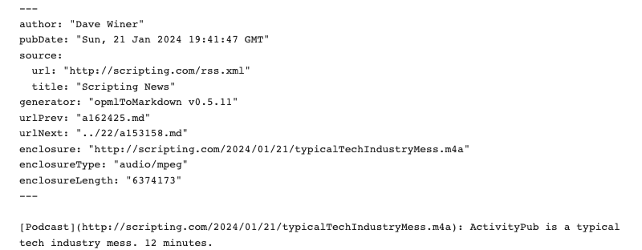

### Example 0

An untitled <a href="http://scripting.com/2024/03/31.html#a164241">blog post</a> from March 21, 2024, explaining how I had been using the OPML format to write and archive my blog writing starting in 2017.  The source attribute provides the address of the feed it came from. When displaying a post you might want to refer to some info from the feed, such as its title, link, icon. 

### Example 1

A <a href="http://scripting.com/2024/03/05/200550.html">titled blog post</a> from March 5, 2024.

### Example 2

This post has a right margin image. 

### Example 3

### Example 4

### Example 5

### Example 6

### Example 7

### Example 8

### Example 9

